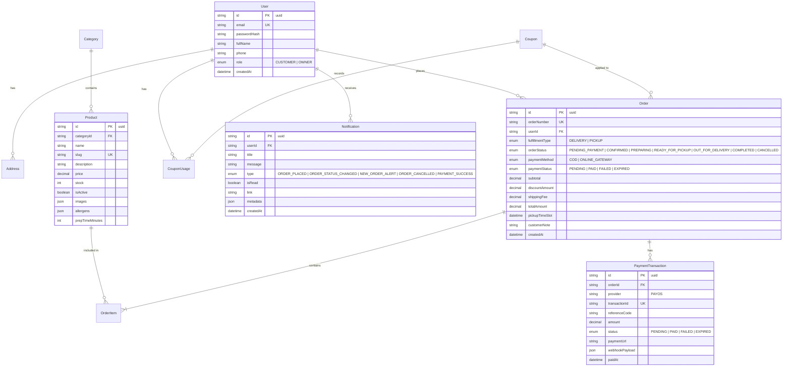
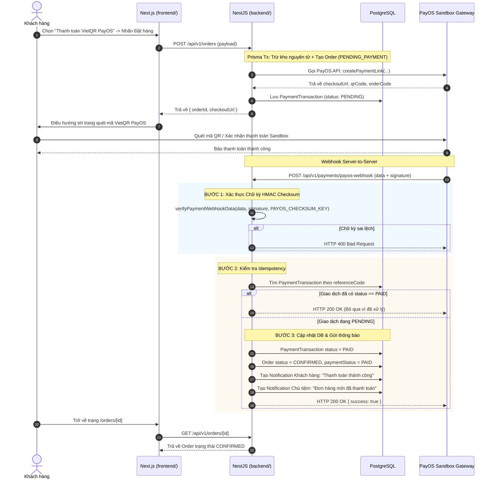
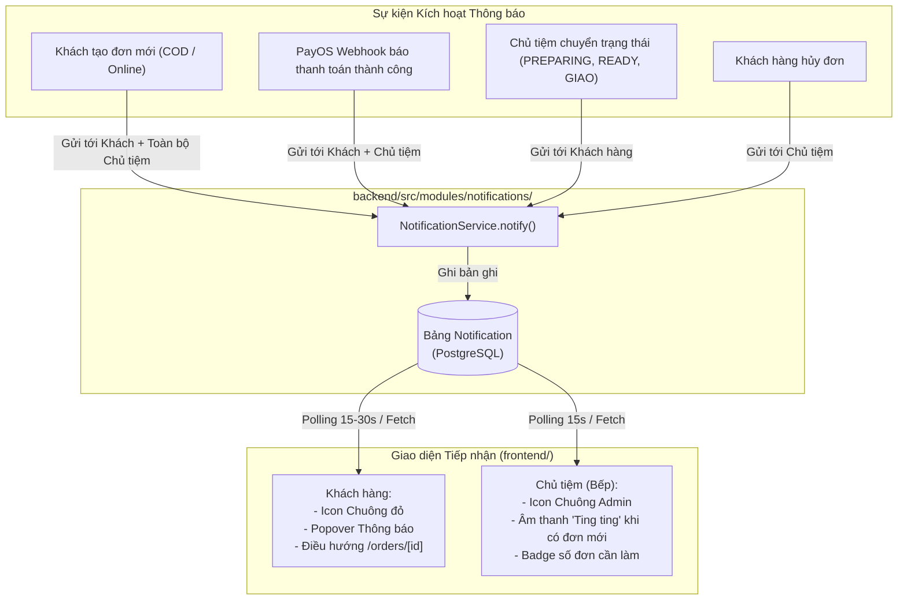

# Bakery Web — Tài liệu Kiến trúc Kỹ thuật (System Architecture Document)

> **Dự án**: Bakery Web (E-commerce MVP cho Tiệm bánh Đơn)  
> **Phiên bản**: 1.1.0 (Kiến trúc phân tách độc lập `frontend` / `backend`, Thuần npm, PayOS Sandbox & Hệ thống Thông báo)  
> **Vai trò**: Senior Software Architect & Tech Lead  
> **Trạng thái**: Đã cập nhật theo yêu cầu Review của Khách hàng  

---

## 1. Tổng quan Kiến trúc Hệ thống (System Overview)

Hệ thống **Bakery Web** được thiết kế phân tách hoàn toàn thành hai ứng dụng độc lập: **`frontend`** (Giao diện người dùng Next.js App Router) và **`backend`** (Máy chủ xử lý nghiệp vụ NestJS REST API), kết nối chung tới một cơ sở dữ liệu quan hệ **PostgreSQL**.

### 1.1. Sơ đồ Kiến trúc Tổng thể (High-Level Architecture)

```mermaid
flowchart TD
    subgraph ClientLayer ["Client Layer (frontend/)"]
        CustomerBrowser["Trình duyệt Khách hàng (Next.js Shop)"]
        AdminBrowser["Trình duyệt Chủ tiệm (Next.js Admin Portal)\n[Âm thanh chuông báo Đơn mới]"]
    end

    subgraph HostingFrontend ["Frontend Hosting (Vercel)"]
        VercelEdge["Next.js 15 App Router\n(SSR / ISR / React Server Components)"]
    end

    subgraph BackendLayer ["Backend API Layer (backend/) - Render / Railway"]
        NestApp["NestJS Application REST API"]
        subgraph NestModules ["NestJS Core Modules"]
            AuthMod["Auth & Users Module"]
            ProdMod["Products & Categories Module"]
            CartMod["Cart & Coupon Engine"]
            OrderMod["Orders & Concurrency Module"]
            PayMod["PayOS Payment & Webhook Module"]
            NotifyMod["System Notifications Module\n(Khách hàng & Chủ tiệm)"]
            PrismaService["Prisma ORM Service"]
        end
    end

    subgraph ExternalServices ["External Services"]
        PayOSGateway["Cổng Thanh toán PayOS Sandbox\n(Mã VietQR Ngân hàng VN)"]
        CloudStorage["Cloudinary / Storage (Ảnh bánh)"]
    end

    subgraph DatabaseLayer ["Database Layer (Supabase / Neon PostgreSQL)"]
        PostgresDB[("PostgreSQL Database\n(Prisma Schema)")]
    end

    CustomerBrowser -->|HTTPS / JSON / Cookies| VercelEdge
    AdminBrowser -->|HTTPS / JSON / Cookies| VercelEdge
    VercelEdge -->|REST API Requests| NestApp

    NestApp --> AuthMod & ProdMod & CartMod & OrderMod & PayMod & NotifyMod
    AuthMod & ProdMod & CartMod & OrderMod & PayMod & NotifyMod --> PrismaService
    PrismaService -->|Connection Pooling| PostgresDB

    OrderMod -->|Tạo Payment Link VietQR| PayOSGateway
    PayOSGateway -->|Webhook (HMAC Checksum)| PayMod
    OrderMod & PayMod -->|Kích hoạt sự kiện thông báo| NotifyMod
    NotifyMod -->|Lưu & Đếm thông báo| PrismaService
    ProdMod -->|Tải ảnh bánh| CloudStorage
```

---

## 2. Cấu trúc Dự án & Chiến lược Quản lý Dependency (Thuần npm)

### 2.1. Quyết định Về Quản lý Dự án & Tooling

Theo yêu cầu trực tiếp từ khách hàng:

1. **Không dùng Turborepo (`turbo`)**: Loại bỏ hoàn toàn Turborepo, chỉ sử dụng thuần **npm scripts**.
2. **Tách biệt hoàn toàn thành 2 thư mục độc lập**: `frontend` và `backend`.
3. **Không tạo thư mục chia sẻ chung**: Không tạo `packages/shared-types` hay `packages/*`. Mỗi dự án (`frontend` và `backend`) hoàn toàn độc lập, tự quản lý dependencies, tsconfig, types/interfaces và scripts riêng biệt.

Ưu điểm của cấu trúc này:

- Tính độc lập tuyệt đối (Decoupling): Đội ngũ làm Frontend hoặc Backend có thể chạy riêng, deploy riêng sang các nền tảng khác nhau mà không bao giờ gặp lỗi thiếu dependency dùng chung.
- Dễ dàng triển khai lên Vercel (`Root Directory: frontend`) và Render (`Root Directory: backend`) mà không cần cấu hình monorepo phức tạp.

### 2.2. Cấu trúc Thư mục Chi tiết

```
bakery-shop/
├── backend/                         # Ứng dụng Backend NestJS (Độc lập 100%)
│   ├── prisma/
│   │   ├── schema.prisma            # Database Schema (Bao gồm bảng Notification)
│   │   ├── migrations/              # Lịch sử migrations
│   │   └── seed.ts                  # Nạp dữ liệu bánh mẫu, admin, coupons
│   ├── src/
│   │   ├── common/                  # Decorators, Filters, Guards, Interceptors, Pipes
│   │   ├── config/                  # Quản lý biến môi trường
│   │   ├── database/                # PrismaService, PrismaModule
│   │   └── modules/
│   │       ├── auth/                # Đăng ký, đăng nhập, JWT, refresh token
│   │       ├── users/               # Hồ sơ, sổ địa chỉ nhận hàng
│   │       ├── categories/          # Quản lý danh mục
│   │       ├── products/            # Quản lý bánh, tồn kho, lọc, tìm kiếm
│   │       ├── coupons/             # Quản lý mã giảm giá, kiểm tra điều kiện
│   │       ├── orders/              # Đặt hàng, trừ kho nguyên tử, đổi trạng thái
│   │       ├── payments/            # Tích hợp PayOS Sandbox, webhook verification
│   │       ├── notifications/       # Hệ thống thông báo (Khách hàng & Chủ tiệm)
│   │       └── uploads/             # Tải ảnh sản phẩm
│   ├── test/                        # Integration & E2E tests
│   ├── nest-cli.json
│   ├── package.json                 # Quản lý dependency riêng của backend
│   └── tsconfig.json
│
├── frontend/                        # Ứng dụng Frontend Next.js (Độc lập 100%)
│   ├── public/                      # Static assets, âm thanh chuông báo (notification.mp3)
│   ├── src/
│   │   ├── app/                     # Next.js 15 App Router
│   │   │   ├── (auth)/              # /login, /register
│   │   │   ├── (shop)/              # /, /products, /cart, /checkout, /orders
│   │   │   └── (admin)/             # /admin/dashboard, /admin/products, /admin/orders...
│   │   ├── components/              # UI components
│   │   │   ├── ui/                  # Button, Dialog, Input, Badge...
│   │   │   ├── layouts/             # Header, Footer, AdminSidebar, NotificationBell
│   │   │   ├── shop/                # ProductCard, CartDrawer, CheckoutForm...
│   │   │   └── admin/               # OrderTable, StockToggle, OrderDetailActions...
│   │   ├── hooks/                   # useCart, useAuth, useNotifications, useSound
│   │   ├── lib/                     # API client wrapper, formatters (VND currency)
│   │   ├── stores/                  # Zustand stores (cartStore)
│   │   └── types/                   # TypeScript interfaces nội bộ của frontend
│   ├── next.config.ts
│   ├── package.json                 # Quản lý dependency riêng của frontend
│   ├── tailwind.config.ts
│   └── tsconfig.json
│
├── docs/                            # Toàn bộ tài liệu kiến trúc & kế hoạch
│   ├── AI_WORKFLOW.md
│   ├── PRODUCT.md
│   ├── ARCHITECTURE.md
│   └── IMPLEMENTATION_PLAN.md
│
├── package.json                     # Root package.json chứa npm scripts tiện ích
└── README.md
```

### 2.3. Quy ước Lệnh Quản trị qua Thuần npm

Root `package.json` chỉ đóng vai trò chứa các alias script tiện lợi để khởi chạy từ thư mục gốc thông qua cờ `--prefix` của npm:

```json
{
  "name": "bakery-shop-root",
  "private": true,
  "scripts": {
    "dev:backend": "npm --prefix backend run start:dev",
    "dev:frontend": "npm --prefix frontend run dev",
    "build:backend": "npm --prefix backend run build",
    "build:frontend": "npm --prefix frontend run build",
    "test:backend": "npm --prefix backend run test",
    "test:frontend": "npm --prefix frontend run test",
    "lint": "npm --prefix backend run lint && npm --prefix frontend run lint"
  }
}
```

---

## 3. Thiết kế Cơ sở Dữ liệu & Prisma Schema (ERD Hoàn chỉnh)

### 3.1. Sơ đồ Quan hệ Thực thể (Entity Relationship Diagram)



### 3.2. Cấu hình Prisma Schema (`backend/prisma/schema.prisma`)

```prisma
datasource db {
  provider = "postgresql"
  url      = env("DATABASE_URL")
}

generator client {
  provider = "prisma-client-js"
}

enum Role {
  CUSTOMER
  OWNER
}

enum FulfillmentType {
  DELIVERY
  PICKUP
}

enum OrderStatus {
  PENDING_PAYMENT
  CONFIRMED
  PREPARING
  READY_FOR_PICKUP
  OUT_FOR_DELIVERY
  COMPLETED
  CANCELLED
}

enum PaymentMethod {
  COD
  ONLINE_GATEWAY
}

enum PaymentStatus {
  PENDING
  PAID
  FAILED
  EXPIRED
  REFUNDED
}

enum DiscountType {
  PERCENTAGE
  FIXED_AMOUNT
}

enum NotificationType {
  ORDER_PLACED          // Khách hàng: Đặt đơn thành công
  ORDER_STATUS_CHANGED  // Khách hàng: Đơn chuyển trạng thái (bếp làm, sẵn sàng lấy/giao)
  NEW_ORDER_ALERT       // Chủ tiệm: Có đơn mới đến cần xử lý
  ORDER_CANCELLED       // Chủ tiệm hoặc Khách hàng: Đơn bị hủy
  PAYMENT_SUCCESS       // Khách hàng: Thanh toán PayOS thành công
}

model User {
  id            String         @id @default(uuid())
  email         String         @unique
  passwordHash  String
  fullName      String
  phone         String?
  role          Role           @default(CUSTOMER)
  createdAt     DateTime       @default(now())
  updatedAt     DateTime       @updatedAt

  addresses     Address[]
  orders        Order[]
  couponUsages  CouponUsage[]
  notifications Notification[]

  @@index([email])
}

model Notification {
  id        String           @id @default(uuid())
  userId    String           // Người nhận thông báo
  title     String           // Tiêu đề ngắn gọn (VD: Đơn hàng mới #BKR-001)
  message   String           // Nội dung chi tiết
  type      NotificationType
  isRead    Boolean          @default(false)
  link      String?          // Đường dẫn điều hướng khi click (VD: /orders/[id] hoặc /admin/orders/[id])
  metadata  Json?            // Chứa { orderId, orderNumber, status, amount }
  createdAt DateTime         @default(now())

  user      User             @relation(fields: [userId], references: [id], onDelete: Cascade)

  @@index([userId, isRead])
  @@index([createdAt])
}

model Address {
  id            String   @id @default(uuid())
  userId        String
  recipientName String
  phone         String
  street        String
  ward          String
  district      String
  city          String
  isDefault     Boolean  @default(false)
  createdAt     DateTime @default(now())

  user          User     @relation(fields: [userId], references: [id], onDelete: Cascade)

  @@index([userId])
}

model Category {
  id          String    @id @default(uuid())
  name        String
  slug        String    @unique
  description String?
  imageUrl    String?
  isActive    Boolean   @default(true)
  sortOrder   Int       @default(0)
  createdAt   DateTime  @default(now())
  updatedAt   DateTime  @updatedAt

  products    Product[]

  @@index([slug])
}

model Product {
  id              String      @id @default(uuid())
  categoryId      String
  name            String
  slug            String      @unique
  description     String
  price           Decimal     @db.Decimal(12, 2)
  originalPrice   Decimal?    @db.Decimal(12, 2)
  stock           Int         @default(0)
  isActive        Boolean     @default(true)
  isFeatured      Boolean     @default(false)
  images          Json        @default("[]") // URLs danh sách ảnh
  allergens       Json        @default("[]") // Danh sách dị ứng: ["Trứng", "Sữa"]
  prepTimeMinutes Int         @default(0)
  createdAt       DateTime    @default(now())
  updatedAt       DateTime    @updatedAt

  category        Category    @relation(fields: [categoryId], references: [id])
  orderItems      OrderItem[]

  @@index([categoryId])
  @@index([slug])
  @@index([isActive])
}

model Coupon {
  id                String        @id @default(uuid())
  code              String        @unique
  description       String?
  discountType      DiscountType
  discountValue     Decimal       @db.Decimal(12, 2)
  minOrderValue     Decimal       @default(0) @db.Decimal(12, 2)
  maxDiscountAmount Decimal?      @db.Decimal(12, 2)
  usageLimit        Int           @default(100)
  usedCount         Int           @default(0)
  userLimit         Int           @default(1)
  startDate         DateTime
  endDate           DateTime
  isActive          Boolean       @default(true)
  createdAt         DateTime      @default(now())
  updatedAt         DateTime      @updatedAt

  usages            CouponUsage[]

  @@index([code])
  @@index([isActive, startDate, endDate])
}

model CouponUsage {
  id        String   @id @default(uuid())
  couponId  String
  userId    String
  orderId   String
  usedAt    DateTime @default(now())

  coupon    Coupon   @relation(fields: [couponId], references: [id])
  user      User     @relation(fields: [userId], references: [id])
  order     Order    @relation(fields: [orderId], references: [id], onDelete: Cascade)

  @@unique([couponId, userId, orderId])
  @@index([userId, couponId])
}

model Order {
  id                 String               @id @default(uuid())
  orderNumber        String               @unique // BKR-YYYYMMDD-XXXX
  userId             String
  fulfillmentType    FulfillmentType
  orderStatus        OrderStatus          @default(PENDING_PAYMENT)
  paymentMethod      PaymentMethod
  paymentStatus      PaymentStatus        @default(PENDING)
  subtotal           Decimal              @db.Decimal(12, 2)
  discountAmount     Decimal              @default(0) @db.Decimal(12, 2)
  shippingFee        Decimal              @default(0) @db.Decimal(12, 2)
  totalAmount        Decimal              @db.Decimal(12, 2)
  couponCode         String?
  recipientName      String
  recipientPhone     String
  deliveryAddress    String?
  pickupTimeSlot     DateTime?
  customerNote       String?
  cancellationReason String?
  createdAt          DateTime             @default(now())
  updatedAt          DateTime             @updatedAt

  user               User                 @relation(fields: [userId], references: [id])
  items              OrderItem[]
  payments           PaymentTransaction[]
  couponUsages       CouponUsage[]

  @@index([userId])
  @@index([orderNumber])
  @@index([orderStatus])
  @@index([createdAt])
}

model OrderItem {
  id           String   @id @default(uuid())
  orderId      String
  productId    String
  productName  String
  productPrice Decimal  @db.Decimal(12, 2)
  quantity     Int
  subtotal     Decimal  @db.Decimal(12, 2)

  order        Order    @relation(fields: [orderId], references: [id], onDelete: Cascade)
  product      Product  @relation(fields: [productId], references: [id])

  @@index([orderId])
  @@index([productId])
}

model PaymentTransaction {
  id                String        @id @default(uuid())
  orderId           String
  provider          String        @default("PAYOS")
  transactionId     String?       @unique
  referenceCode     String        // PayOS orderCode dạng số nguyên
  amount            Decimal       @db.Decimal(12, 2)
  currency          String        @default("VND")
  status            PaymentStatus @default(PENDING)
  paymentUrl        String?
  rawPayload        Json?
  webhookPayload    Json?
  signatureVerified Boolean       @default(false)
  paidAt            DateTime?
  createdAt         DateTime      @default(now())
  updatedAt         DateTime      @updatedAt

  order             Order         @relation(fields: [orderId], references: [id], onDelete: Cascade)

  @@index([orderId])
  @@index([referenceCode])
}
```

---

## 4. Tích hợp PayOS Sandbox (VietQR) & Xử lý Webhook Idempotency

### 4.1. Quy trình Thanh toán PayOS Sandbox



#### Quy tắc bảo mật PayOS Webhook

1. **PayOS Checksum Verification**: Xác minh tính toàn vẹn dữ liệu bằng cách sắp xếp các trường alphabet và tạo HMAC-SHA256 với `PAYOS_CHECKSUM_KEY`.
2. **Idempotency**: Nếu nhận trùng webhook nhiều lần (do mạng thử lại), hệ thống chỉ thực hiện cập nhật và tạo thông báo đúng 1 lần duy nhất.

---

## 5. Thiết kế Hệ thống Thông báo (System Notifications Architecture)

Hệ thống thông báo được xây dựng nhằm giải quyết triệt để bài toán đồng bộ thông tin giữa **Khách hàng** và **Chủ tiệm bánh**.



### 5.1. Các Kịch bản Thông báo Chi tiết

| Sự kiện | Người nhận | Tiêu đề | Nội dung chi tiết | Link điều hướng |
| :--- | :--- | :--- | :--- | :--- |
| **Đơn hàng mới tạo** | Khách hàng | Đặt đơn thành công! | Đơn hàng `#BKR-xxx` đã được tạo thành công. Tiệm đang chuẩn bị xác nhận. | `/orders/:id` |
| **Đơn hàng mới đến** | Chủ tiệm (`OWNER`) | 🔔 ĐƠN HÀNG MỚI! | Khách đặt đơn `#BKR-xxx` (X cái bánh - Y đ). Vui lòng kiểm tra và bắt đầu làm bánh! | `/admin/orders/:id` |
| **Thanh toán PayOS thành công** | Khách hàng | Thanh toán thành công! | Đơn hàng `#BKR-xxx` đã thanh toán thành công qua PayOS VietQR. | `/orders/:id` |
| **Bếp bắt đầu làm** | Khách hàng | Tiệm đang làm bánh 👨‍🍳 | Thợ bánh đang tiến hành chuẩn bị và nướng bánh cho đơn `#BKR-xxx` của bạn. | `/orders/:id` |
| **Bánh sẵn sàng tại tiệm** | Khách hàng | Bánh đã sẵn sàng 🎂 | Bánh của bạn đã đóng hộp sẵn tại cửa hàng. Bạn có thể ghé lấy theo khung giờ hẹn! | `/orders/:id` |
| **Bánh đang được giao** | Khách hàng | Bánh đang được giao 🛵 | Shipper đang trên đường giao đơn bánh thơm ngon tới địa chỉ của bạn. | `/orders/:id` |
| **Khách hủy đơn** | Chủ tiệm (`OWNER`) | Đơn hàng đã bị hủy | Khách hàng đã hủy đơn `#BKR-xxx`. Số lượng bánh đã được hoàn trả lại kho. | `/admin/orders/:id` |

### 5.2. Cơ chế Đồng bộ & Trải nghiệm Âm thanh (Audio Alert)

1. **Cơ chế Đồng bộ (Data Synchronization)**:
   - Sử dụng **Lightweight SWR / React Query Polling**:
     - Màn hình Admin chủ tiệm gọi API `GET /api/v1/notifications/unread-count` mỗi **15 giây**.
     - Màn hình Khách hàng gọi API kiểm tra mỗi **30 giây**.
   - Phương án này cực kỳ bền bỉ trên môi trường Free-tier (không bị ngắt kết nối WebSocket đột ngột do serverless timeout).
2. **Âm thanh Chuông báo cho Chủ tiệm (Audio Notification)**:
   - File âm thanh `public/audio/new-order-chime.mp3` được tích hợp trên Admin layout.
   - Khi hook `useNotifications` phát hiện có thông báo mới thuộc loại `NEW_ORDER_ALERT`, ứng dụng tự động phát âm thanh chuông báo để nhắc thợ bánh trong bếp ngay cả khi đang mở tab khác.

---

## 6. Danh sách API Endpoints Cập nhật

| Nhóm | Method | Endpoint | Quyền hạn | Mô tả |
| :--- | :--- | :--- | :--- | :--- |
| **Auth** | `POST` | `/api/v1/auth/register` | Public | Đăng ký tài khoản |
| | `POST` | `/api/v1/auth/login` | Public | Đăng nhập (Set HttpOnly Cookie) |
| | `POST` | `/api/v1/auth/refresh` | Public | Xoay vòng Refresh Token |
| | `POST` | `/api/v1/auth/logout` | Auth | Đăng xuất |
| | `GET` | `/api/v1/auth/me` | Auth | Lấy thông tin tài khoản hiện tại |
| **Users** | `PUT` | `/api/v1/users/profile` | Auth | Cập nhật hồ sơ cá nhân |
| | `GET` | `/api/v1/users/addresses` | Auth | Danh sách sổ địa chỉ nhận hàng |
| | `POST` | `/api/v1/users/addresses` | Auth | Thêm địa chỉ mới |
| | `DELETE` | `/api/v1/users/addresses/:id` | Auth | Xóa địa chỉ |
| **Products** | `GET` | `/api/v1/products` | Public | Danh sách bánh (lọc, tìm kiếm, phân trang) |
| | `GET` | `/api/v1/products/:slug` | Public | Chi tiết bánh theo slug URL |
| | `POST` | `/api/v1/products` | Owner | Thêm bánh mới |
| | `PUT` | `/api/v1/products/:id` | Owner | Sửa thông tin bánh |
| | `PATCH` | `/api/v1/products/:id/stock` | Owner | Cập nhật nhanh số lượng tồn kho |
| | `PATCH` | `/api/v1/products/:id/toggle` | Owner | Bật/Tắt mở bán bánh |
| **Categories** | `GET` | `/api/v1/categories` | Public | Danh sách danh mục bánh |
| | `POST` | `/api/v1/categories` | Owner | Tạo danh mục mới |
| **Coupons** | `POST` | `/api/v1/coupons/validate` | Auth | Kiểm tra tính hợp lệ & tính tiền giảm |
| | `GET` | `/api/v1/coupons` | Owner | Danh sách mã coupon quản trị |
| | `POST` | `/api/v1/coupons` | Owner | Tạo mã coupon mới |
| **Orders** | `POST` | `/api/v1/orders` | Auth | Tạo đơn hàng (Trừ kho nguyên tử + Báo thông báo) |
| | `GET` | `/api/v1/orders` | Auth | Danh sách đơn hàng của tôi |
| | `GET` | `/api/v1/orders/:id` | Auth | Chi tiết đơn hàng |
| | `POST` | `/api/v1/orders/:id/cancel` | Auth | Khách hủy đơn (nếu chưa PREPARING) |
| **Admin Orders** | `GET` | `/api/v1/admin/orders` | Owner | Xem toàn bộ đơn hàng của tiệm |
| | `PATCH` | `/api/v1/admin/orders/:id/status` | Owner | Chuyển trạng thái đơn (Bếp làm, sẵn sàng...) |
| **Payments** | `POST` | `/api/v1/payments/payos/create-link` | Auth | Tạo link thanh toán PayOS VietQR |
| | `POST` | `/api/v1/payments/payos-webhook` | Public | Nhận webhook PayOS (Xác minh chữ ký) |
| **Notifications** | `GET` | `/api/v1/notifications` | Auth | Danh sách thông báo phân trang của tôi |
| | `GET` | `/api/v1/notifications/unread-count` | Auth | Số lượng thông báo chưa đọc (hiển thị badge) |
| | `PATCH` | `/api/v1/notifications/:id/read` | Auth | Đánh dấu một thông báo đã đọc |
| | `PATCH` | `/api/v1/notifications/read-all` | Auth | Đánh dấu tất cả thông báo đã đọc |
| **Uploads** | `POST` | `/api/v1/uploads/image` | Owner | Tải ảnh bánh lên Cloudinary |

---

## 7. Triển khai Độc lập & Chi phí Vận hành 0 VNĐ

Do `frontend` và `backend` hoàn toàn độc lập, việc cấu hình triển khai trở nên cực kỳ đơn giản:

| Ứng dụng | Nền tảng Deploy | Cấu hình Thư mục Gốc | Chi phí |
| :--- | :--- | :--- | :--- |
| **Frontend** | **Vercel** | `Root Directory: frontend` | $0 (Hobby Free) |
| **Backend** | **Render.com** / **Railway** | `Root Directory: backend` | $0 (Free Web Service) |
| **Database** | **Supabase** / **Neon** | Kết nối qua `DATABASE_URL` | $0 (Free 500MB PostgreSQL) |
| **Ảnh bánh** | **Cloudinary** | API Key trong biến môi trường `backend/.env` | $0 (25GB băng thông) |
| **Thanh toán** | **PayOS Sandbox** | Client ID, API Key, Checksum Key trong `backend/.env` | $0 (Môi trường test miễn phí) |
